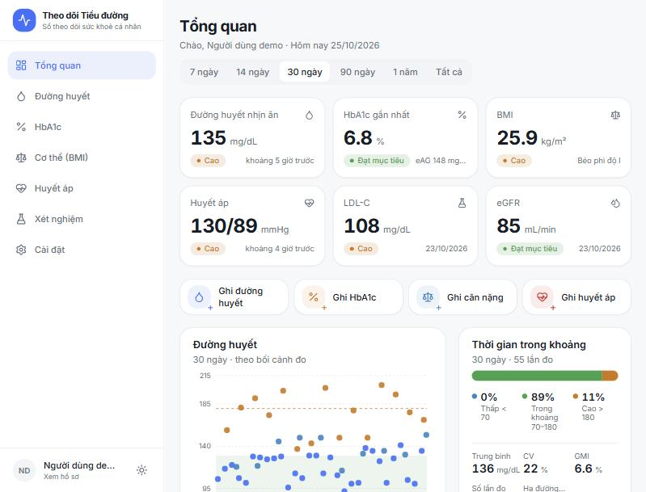

# Theo dõi Tiểu đường

**Dùng thử ngay:** https://minh-lgm.github.io/diabetes/

Ứng dụng web tiếng Việt giúp người bị tiểu đường tự theo dõi đường huyết, HbA1c, BMI, huyết áp, mỡ máu và chức năng thận tại nhà. Mọi dữ liệu được lưu ngay trong trình duyệt của bạn (IndexedDB) — không tài khoản, không máy chủ, không gửi dữ liệu đi đâu. Giao diện mobile-first, có chế độ sáng/tối.



## Tính năng chính

- **Tổng quan:** chỉ số mới nhất, trạng thái so với mục tiêu, trung bình / GMI / Time-in-Range / CV.
- **Đường huyết:** ghi theo bối cảnh (nhịn ăn, trước/sau ăn, trước ngủ, bất kỳ), biểu đồ, lọc theo khoảng thời gian.
- **HbA1c:** lịch sử, quy đổi mmol/mol (IFCC) và eAG, xu hướng.
- **Cơ thể / BMI:** cân nặng, vòng eo, BMI phân loại theo chuẩn châu Á.
- **Huyết áp:** tâm thu / tâm trương / mạch, đánh giá theo mục tiêu ADA.
- **Xét nghiệm:** mỡ máu (Total-C, LDL, HDL, TG) và thận (creatinine, eGFR, UACR).
- **Cài đặt:** hồ sơ, đơn vị mg/dL hoặc mmol/L, giao diện sáng/tối, mục tiêu cá nhân, xuất / nhập JSON, dữ liệu demo.
- Mục tiêu mặc định theo ADA Standards of Care 2025, có thể chỉnh theo chỉ định của bác sĩ.

## Chạy ứng dụng

Yêu cầu: Node.js 20+ và npm.

```bash
npm install
npm run dev       # chạy dev server tại http://localhost:5173
npm run build     # kiểm tra kiểu + build ra dist/
npm run preview   # xem thử bản build
```

Khi deploy static (Vercel / Netlify / GitHub Pages) cần bật SPA fallback về `index.html` — xem [docs/ARCHITECTURE.md](docs/ARCHITECTURE.md#8-chạy-và-build).

## Cấu trúc thư mục (rút gọn)

```
src/
├── pages/            # mỗi route một trang, chỉ compose
├── features/         # form / danh sách / biểu đồ theo từng miền
├── components/
│   ├── ui/           # UI kit dùng chung
│   └── charts/       # theme và biểu đồ
├── hooks/            # useProfile, useTheme
├── lib/              # calc (công thức), targets, labels, dates, seed
├── db.ts             # Dexie (IndexedDB) + export/import
└── types.ts          # mô hình dữ liệu
docs/                 # PLAN, ARCHITECTURE, DESIGN
```

## Tài liệu

- [Kế hoạch sản phẩm — docs/PLAN.md](docs/PLAN.md)
- [Kiến trúc kỹ thuật — docs/ARCHITECTURE.md](docs/ARCHITECTURE.md)
- [Thiết kế giao diện — docs/DESIGN.md](docs/DESIGN.md)

## Lưu ý về dữ liệu

Dữ liệu chỉ nằm trong trình duyệt trên thiết bị này. Xoá cache / dữ liệu trang web hoặc đổi thiết bị sẽ làm mất dữ liệu — hãy **xuất file JSON sao lưu định kỳ** trong Cài đặt.

## Tuyên bố miễn trừ y khoa

Ứng dụng chỉ hỗ trợ ghi chép và theo dõi cá nhân, **không thay thế tư vấn, chẩn đoán hay điều trị của bác sĩ**. Ngưỡng mặc định dựa trên khuyến cáo chung; mục tiêu cá nhân do bác sĩ điều trị quyết định. Không tự ý thay đổi thuốc hay liều insulin dựa trên ứng dụng này. Khi có triệu chứng bất thường, hãy liên hệ cơ sở y tế.

## License

[MIT](LICENSE)
